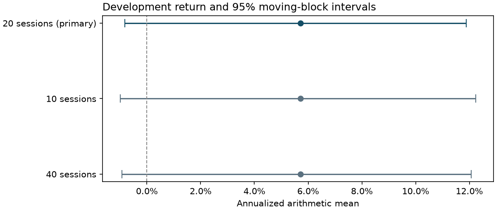
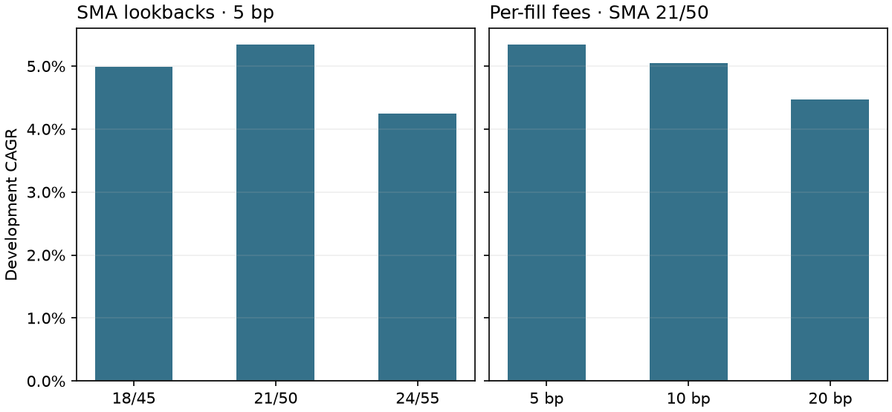

# Phase 4 statistical robustness and bias review

The analysis covers 2,012 development sessions from 2011-01-03 through 2018-12-31. The frozen rule starts with $100,000, earns zero interest on idle cash and applies 5 bp per fill in the reference case. This is development-period evidence for a hypothetical strategy.

## Return uncertainty

The mean net daily return was 0.02271%. The annualized arithmetic mean was 5.72% and the geometric CAGR was 5.34%. Annualized arithmetic mean multiplies the daily mean by 252. CAGR takes the geometric growth of the ending balance.

Closing shares were positive on 1,345 sessions (66.85%). Mean closing invested weight was 66.59%. Annualized gross turnover was 550.06% of prior equity (43.92× across development). Buys and sells each enter gross turnover at full notional.

The tested null is zero mean net daily return. Two-sided inference uses the 95% percentile interval. Non-circular blocks were sampled with replacement from simple daily returns, with 20,000 replications per length and PCG64 seed 20261127. The primary choice is 20 sessions.

| Block | Daily 95% interval | Annualized arithmetic 95% interval | Zero excluded |
| --- | ---: | ---: | --- |
| 20 | [-0.00325%, 0.04713%] | [-0.82%, 11.88%] | No |
| 10 | [-0.00394%, 0.04854%] | [-0.99%, 12.23%] | No |
| 40 | [-0.00371%, 0.04790%] | [-0.93%, 12.07%] | No |

An interval including zero leaves the mean unresolved under the protocol. It supplies no proof that a predictive effect is absent. The intervals rely on approximate stationarity and sufficient dependence coverage within blocks. They are conditional on the chosen rule and development window and do not adjust for historical selection.

## Prespecified diagnostic runs

Each case recomputes costs, shares, cash and equity. Two implementations agree on the dates, decisions, fills, distributions and daily equity. Parameter cases are exploratory. The cost grid illustrates model sensitivity to fees and uses no verified historical fill costs.

| SMA | Fee per fill | Fills | Cost | Total return | CAGR | Max drawdown |
| --- | ---: | ---: | ---: | ---: | ---: | ---: |
| 18/45 | 5 bp | 52 | $2,955.66 | 47.46% | 4.98% | 20.48% |
| 21/50 | 5 bp | 44 | $2,405.07 | 51.46% | 5.34% | 25.60% |
| 24/55 | 5 bp | 40 | $2,152.83 | 39.34% | 4.24% | 26.76% |
| 21/50 | 10 bp | 44 | $4,754.49 | 48.18% | 5.05% | 25.75% |
| 21/50 | 20 bp | 44 | $9,291.38 | 41.81% | 4.47% | 26.04% |

## Signal timing and descriptive labels

Close-based signals are available after the final close of the corresponding period. Trade and regime consumption is eligible at the following scheduled open. The weekly definition uses Monday–Sunday weeks and the monthly definition uses calendar months. An incomplete week at the sample end supplies no period observation. Weekly and monthly labels are descriptive and place no orders.

| Frequency | Completed bars | Warmup | Ready | Long | Cash | Enter | Exit | First ready |
| --- | ---: | ---: | ---: | ---: | ---: | ---: | ---: | --- |
| daily | 2012 | 49 | 1963 | 1345 | 618 | 22 | 22 | 2011-03-15 |
| weekly | 417 | 49 | 368 | 320 | 48 | 2 | 1 | 2011-12-16 |
| monthly | 96 | 49 | 47 | 47 | 0 | 1 | 0 | 2015-02-27 |

Monthly counts have few transitions and no regime-conditioned inference is made. The code and saved ledgers pass the timing checks. Controlled early fills and early label releases are challenged in tests, separately from the observed SPY findings. The data do not measure vendor publication latency or historical execution feasibility.

## Findings

| ID | Status | Criterion | Evidence |
| --- | --- | --- | --- |
| P401 | PASS | Integrity and scope | Phase 1–3 references and protocol verified. Development rows matched the calendar. |
| P402 | PASS | Timing and code-level leakage | Checked 44 fills and closing exposure. A future-price perturbation preserved the development prefix. |
| P403 | PASS | Uncertainty calculation | Ledger returns matched the reviewer ledger. Explicit block concatenation and deterministic benchmark tests check the sampler. |
| P404 | INCONCLUSIVE | Positive development-period mean | Protocol requires strictly positive lower bounds for all block lengths. See bootstrap.csv. |
| P405 | PASS | Exploratory parameter and cost diagnostics | Two independent calculation paths agreed. This checks implementation. |
| P406 | PASS | Descriptive period timing | Complete exchange periods and next-open release checked for each frequency. |
| P407 | INCONCLUSIVE | Predictive reliability and incremental value | No untouched evaluation, risk comparison or benchmark test. |
| P408 | INCONCLUSIVE | Historical selection and implementation bias | No selection provenance, publication latency, actual fills or payment-date cash records. |

No independent selection history is available for the asset, sample dates, or moving averages. The statistical screen is conditional on this selected development sample. Long SPY exposure can contribute to returns, so incremental value remains unresolved without a prespecified benchmark or risk comparison. Ex-date cash timing retains the Phase 3 limitation.

See the [protocol](../../reports/statistical-protocol.md) for the hypotheses, fixed settings and criterion definitions.
