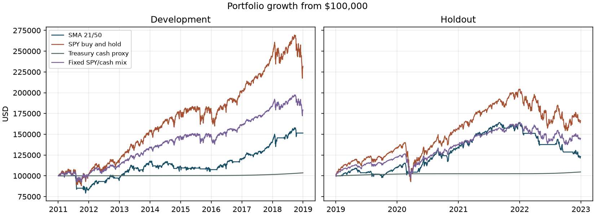
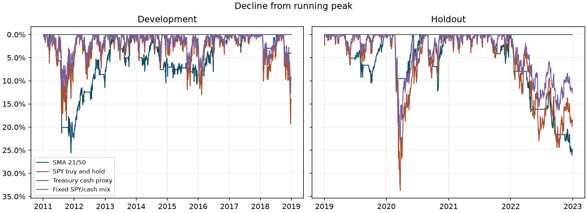

# Phase 5 benchmark and out-of-sample review

This is a one-shot evaluation of a hypothetical strategy under the frozen protocol. Each window starts with $100,000 and zero shares. The holdout initial target uses the final 50 development closes. All four books share matched sessions, a provider price basis, and common per-share distributions and trading fees on SPY fills.

On 2019-01-02, the carried-forward SMA target from 2018-12-31 was cash. The first open required no SMA fill. The first session included no carryover cash interest, inventory or distribution entitlement.

## Performance

| Window | Portfolio | Sessions | Cumulative | CAGR | Volatility | Excess Sharpe | Max drawdown | Underwater sessions | Mean SPY weight | Cost |
| --- | --- | ---: | ---: | ---: | ---: | ---: | ---: | ---: | ---: | ---: |
| development | SMA 21/50 | 2012 | 51.46% | 5.34% | 10.19% | 0.519 | 25.60% | 643 | 66.59% | $2,405.07 |
| development | SPY buy and hold | 2012 | 131.79% | 11.10% | 14.50% | 0.769 | 19.33% | 192 | 99.99% | $63.58 |
| development | Treasury cash proxy | 2012 | 3.56% | 0.44% | 0.05% | Undefined | 0.00% | 13 | 0.00% | $0.00 |
| development | Fixed SPY/cash mix | 2012 | 79.31% | 7.59% | 9.58% | 0.766 | 12.79% | 192 | 66.59% | $71.47 |
| holdout | SMA 21/50 | 1008 | 23.14% | 5.34% | 13.68% | 0.366 | 26.13% | 334 | 70.30% | $1,056.50 |
| holdout | SPY buy and hold | 1008 | 66.20% | 13.54% | 22.54% | 0.627 | 33.70% | 250 | 99.99% | $54.88 |
| holdout | Treasury cash proxy | 1008 | 4.63% | 1.14% | 0.10% | Undefined | 0.00% | 4 | 0.00% | $0.00 |
| holdout | Fixed SPY/cash mix | 1008 | 45.06% | 9.75% | 14.78% | 0.627 | 23.16% | 250 | 66.66% | $65.59 |

CAGR uses 252 trading sessions per year. Sharpe uses daily excess returns over the common DTB3 accrual proxy. The cash book has undefined Sharpe because its theoretical excess return is zero each day. Drawdown duration is the longest consecutive run below an equity peak, including open drawdowns at the sample end. Gross turnover and dollar distributions are in the comparison CSV.

## Paired return differences

Differences are SMA minus benchmark. The compounded gap subtracts cumulative portfolio returns. The uncertainty column is the 95% interval for the paired arithmetic mean times 252.

| Window | Benchmark | Compounded gap | Annualized arithmetic gap | 95% interval |
| --- | --- | ---: | ---: | ---: |
| development | Fixed SPY/cash mix | -27.85% | -2.05% | [-7.01%, 2.47%] |
| development | SPY buy and hold | -80.33% | -5.86% | [-12.04%, -0.08%] |
| development | Treasury cash proxy | 47.90% | 5.28% | [-1.25%, 11.44%] |
| holdout | Fixed SPY/cash mix | -21.92% | -4.25% | [-13.31%, 7.01%] |
| holdout | SPY buy and hold | -43.06% | -9.11% | [-21.91%, 7.09%] |
| holdout | Treasury cash proxy | 18.51% | 5.01% | [-7.04%, 17.91%] |

The primary compounded gap was -21.92%. The primary result uses the prespecified joint interval and compounded-gap criterion. Secondary and development intervals are descriptive. The intervals retain within-block dependence and are conditional on this sample and the block design.

## Prespecified context windows

| Window | Portfolio | Actual dates | Sessions | Cumulative return |
| --- | --- | --- | ---: | ---: |
| 2019 calendar year | SMA 21/50 | 2019-01-02 to 2019-12-31 | 252 | 9.79% |
| 2019 calendar year | SPY buy and hold | 2019-01-02 to 2019-12-31 | 252 | 33.26% |
| 2019 calendar year | Treasury cash proxy | 2019-01-02 to 2019-12-31 | 252 | 2.11% |
| 2019 calendar year | Fixed SPY/cash mix | 2019-01-02 to 2019-12-31 | 252 | 22.25% |
| 2020 selloff | SMA 21/50 | 2020-02-19 to 2020-03-23 | 24 | -9.09% |
| 2020 selloff | SPY buy and hold | 2020-02-19 to 2020-03-23 | 24 | -33.38% |
| 2020 selloff | Treasury cash proxy | 2020-02-19 to 2020-03-23 | 24 | 0.08% |
| 2020 selloff | Fixed SPY/cash mix | 2020-02-19 to 2020-03-23 | 24 | -22.91% |
| 2020 rebound | SMA 21/50 | 2020-03-24 to 2020-12-31 | 197 | 29.09% |
| 2020 rebound | SPY buy and hold | 2020-03-24 to 2020-12-31 | 197 | 69.86% |
| 2020 rebound | Treasury cash proxy | 2020-03-24 to 2020-12-31 | 197 | 0.09% |
| 2020 rebound | Fixed SPY/cash mix | 2020-03-24 to 2020-12-31 | 197 | 42.14% |
| 2022 calendar year | SMA 21/50 | 2022-01-03 to 2022-12-30 | 251 | -24.41% |
| 2022 calendar year | SPY buy and hold | 2022-01-03 to 2022-12-30 | 251 | -18.18% |
| 2022 calendar year | Treasury cash proxy | 2022-01-03 to 2022-12-30 | 251 | 2.03% |
| 2022 calendar year | Fixed SPY/cash mix | 2022-01-03 to 2022-12-30 | 251 | -11.40% |

Window returns use the preceding close or the initial cash balance. They describe behavior in named historical periods. The benchmarks differ in realized exposure and exposure timing. A drawdown or return gap cannot isolate the timing effect from exposure, cash yield and fee drag.

## Reviewer reconciliation and limitations

The development strategy matched the Phase 3 frozen reviewer path to 4.955E-35. The largest ledger identity residual across both windows was 6.856E-23. The independent checks validate prior-close entitlement, cash accrual, the next eligible open, common fill costs, exact post-fee opening target weight, and daily share/cash/mark identities.

Historical DTB3 rates are verified. They support a synthetic lagged cash accrual using a 91-day bill-price conversion. The cash proxy does not replicate executable bill total returns or broker cash yields. The source vintage was retrieved after the evaluation periods. Using ex-date credits can advance spendability relative to settlement. The original SMA retains zero idle cash interest. Buy and hold reinvests from the following session open. These assumptions can affect relative performance.

| ID | Status | Criterion | Evidence |
| --- | --- | --- | --- |
| P501 | PASS | Frozen input and protocol integrity | Verified all carried-forward hashes and the independent DTB3 snapshot. |
| P502 | PASS | Matched sessions and one-shot boundary | Claimed holdout once. All books match the 1008 holdout calendar sessions. |
| P503 | PASS | Independent timing and accounting reconciliation | All portfolio ledgers reconciled. Development SMA reference maximum difference 4.955E-35. |
| P504 | INCONCLUSIVE | Primary out-of-sample incremental performance | Both compounded return gap and the paired mean-difference interval must support the same direction. |
| P505 | INCONCLUSIVE | Realistic cash implementation | Verified historical rates support a synthetic proxy. Executable bill total returns and broker yields are unavailable. |
| P506 | INCONCLUSIVE | Causal attribution and generalization | One asset and one holdout. Exposure, timing, costs and idle cash economics differ. |

See the [frozen protocol](../../reports/evaluation-protocol.md) for rules and decision thresholds. Phase 3 and Phase 4 conclusions remain in their original evidence.
