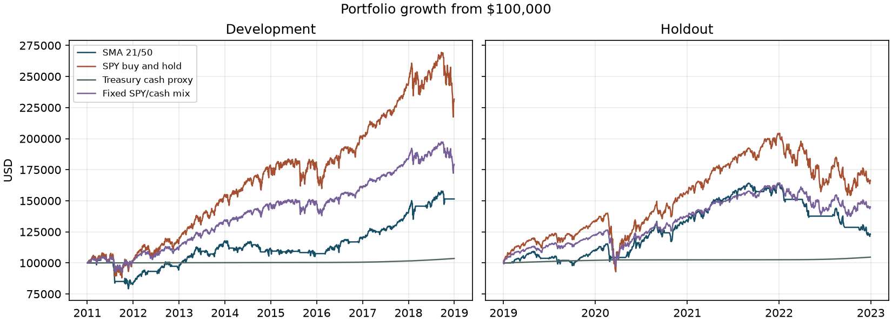
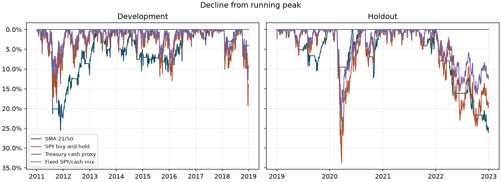
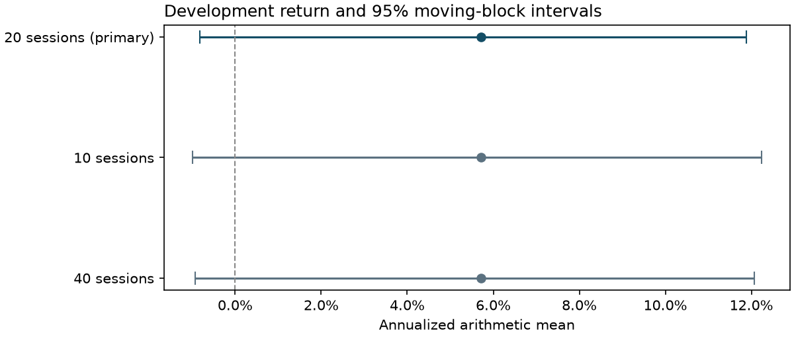

# Independent Model & Strategy Validation
## Noether Meridian · Service 02 · Unit 1
Internal methodology demonstration | 27 November 2026 | Sign-off PENDING

### Executive summary
**Mathematical reproduction passed. Statistical reliability and incremental economic value remain inconclusive.** The independent development reproduction matched all 57 field checks. The 2011–2018 SMA CAGR was 5.34%, but all three bootstrap intervals for mean return included zero. In the 2019–2022 holdout, the SMA gained 23.14%, versus 45.06% for the fixed mix and 66.20% for buy and hold. The SMA trailed the fixed mix by 21.92 percentage points cumulatively. The paired annualized arithmetic difference was −4.25 points, with a 95% interval of −13.31 to +7.01 points. [E03–E05]

**Scope disclaimer.** There is no real client or client model. The term “submission” refers to the internally simulated Phase 2 implementation. This work demonstrates the methods Noether Meridian would use with future clients. The evidence applies only to this hypothetical SPY strategy and the modeled assumptions.

## 02.01 Independent validation question, inventory and scope
Would an independent reviewer reproduce the specified decisions and ledgers, identify bias or implementation limitations, and find evidence of useful incremental performance versus predeclared alternatives?

| Inventory | Specification |
| --- | --- |
| Model | Long SPY when completed daily SMA21 strictly exceeds SMA50. Otherwise cash. Warmup and ties target cash. |
| Timing and funding | Signals after close, fills next available session open. USD 100,000 starting cash, fractional shares, no leverage or shorts. |
| Accounting | 5 bp per fill. Mark at each close. Credit distributions on modeled ex dates to prior-close shares. Zero interest on SMA cash. |
| Development | 2011-01-03 through 2018-12-31, 2,012 sessions. |
| Holdout | 2019-01-02 through 2022-12-30, 1,008 sessions. Fresh cash and no shares. Final 50 development closes initialize the signal. |
| Benchmarks | SPY buy and hold, DTB3 cash proxy, and monthly rebalanced SPY/cash mix targeting 66.587695% SPY from development. |

**Independence declaration.** The Phase 3 reviewer used a separate decimal implementation without importing or invoking the Phase 2 simulator. Phase 5 used reviewer accounting and separate ledger checks. This is computational separation within an internal exercise. No independent human approval or external assurance is recorded. Phase 6 reviewed saved evidence and ran existing tests. [E02, E03, E05, E07]

<!-- pagebreak -->

## 02.02 Frozen inputs and reproduced calculations

**Market source.** Yahoo Finance via yfinance 1.8.0 supplied SPY daily USD bars. The successful snapshot was retrieved 2026-11-26 at 19:35:08 UTC. The request ran from 2011-01-01 inclusive to 2023-01-01 exclusive, with daily interval, auto adjustment and repair disabled, actions and keepna enabled. The raw CSV preserves the returned library table. The analysis copy labels dates in America/New_York. Yahoo data are vendor observations and subject to revisions. [E01]

**Quality and integrity.** All 3,020 expected XNYS proxy sessions were present, with no duplicates, missing required observations or invalid OHLC values in the successful audit. The snapshot recorded 48 dividend events and no splits. Four large daily moves were review flags and have no independent error determination. Phase 1 preserved an initial calendar-boundary failure and the subsequent successful snapshot. Phase 6 verified prior manifest references, including frozen market inputs and the holdout claim. [E01, E07]

**Independent calculation.** The reviewer summed complete 21- and 50-close windows, generated targets, and used the prior close's target at the next open. For a buy, gross notional equals available cash divided by 1.0005. Closing equity equals cash plus shares times closing price. All 44 development fills reconciled. The maximum absolute daily equity difference was USD 2.90 × 10⁻¹⁰. Dates and labels matched exactly. Absolute tolerances were USD 10⁻¹⁰ for price, 10⁻⁹ shares for quantity, USD 10⁻⁸ for accounting and 10⁻¹² for statistics, plus 10⁻¹² times the absolute client value. Phase 2 supplied equity without reported performance metrics. Phase 3 separately calculated values from both equity paths. [E02, E03]

## 02.03 Bias, leakage, overfitting and uncertainty

The prior-close timing audit and future-price perturbation passed. Weekly and monthly labels used completed periods and next-session availability and placed no trades. Controlled tests deliberately injected same-close fills, omitted fees, duplicate dividend credits, premature warmup, shifted signals, incorrect drawdown and bad inputs. These fixtures detected errors by design and are separate from observed SPY findings. [E03, E04, E07]

| Development diagnostic | Result |
| --- | --- |
| Mean net daily return | 0.02271%. Annualized arithmetic mean 5.72%. Geometric CAGR 5.34%. |
| 95% block-bootstrap intervals, annualized mean | 20-session primary: −0.82% to +11.88%. 10 sessions: −0.99% to +12.23%. 40 sessions: −0.93% to +12.07%. |
| Lookback sensitivity, 5 bp | CAGR 4.98% at 18/45, 5.34% at 21/50, 4.24% at 24/55. |
| Trading cost sensitivity, 21/50 | CAGR 5.34%, 5.05%, 4.47% at 5, 10, 20 bp per fill. |

Two-sided zero-mean screen. The moving-block bootstrap sampled consecutive daily returns with 20,000 draws per length, using PCG64 seed 20261127. It relies on approximate stationarity and dependence captured within blocks. The intervals include zero, leaving the positive mean unresolved. Historical selection of SPY, dates and SMA parameters lacks independent provenance. The exploratory cases support no parameter selection. [E04]

<!-- pagebreak -->

## 02.04 Benchmark, scenario, portfolio and risk assessment

All four ledgers use matched sessions and a common provider price basis. SPY fills pay 5 bp. Buy and hold reinvests distributions at the next open. The fixed mix rebalances at the first monthly open after costs. The first holdout SMA target was cash, based on the 2018-12-31 close, and required no initial fill. [E05]

| Portfolio | Dev. total | Dev. CAGR | Holdout total | Holdout CAGR | Holdout max DD |
| --- | --- | --- | --- | --- | --- |
| SMA 21/50 | 51.46% | 5.34% | 23.14% | 5.34% | 26.13% |
| SPY buy and hold | 131.79% | 11.10% | 66.20% | 13.54% | 33.70% |
| Treasury cash proxy | 3.56% | 0.44% | 4.63% | 1.14% | <0.01% |
| Fixed SPY/cash mix | 79.31% | 7.59% | 45.06% | 9.75% | 23.16% |

*Figure 1. Growth from USD 100,000 by window. Portfolios reset at the boundary. Source E05.*

The fixed mix was the primary comparator. The observed −21.92-point cumulative gap is a difference in compounded total returns. The −4.25-point annualized arithmetic gap is 252 times the mean of aligned daily differences. Its 95% interval was −13.31 to +7.01 points using a paired moving-block bootstrap (20 sessions, 20,000 draws, PCG64 seed 20261127). The primary protocol requires a consistent direction in both the cumulative gap and the interval. The result is inconclusive, and the interval does not establish absence of predictive ability. Both secondary holdout intervals also crossed zero. [E05]

During the prespecified 2020 selloff, the SMA lost 9.09% versus 22.91% for the fixed mix. In the rebound it gained 29.09% versus 42.14%. In 2022 it lost 24.41% versus 11.40%. These descriptive windows cannot isolate the effects of exposure, timing, fee drag or cash yield. [E05]

<!-- pagebreak -->

## 02.04 Risk and accounting comparability

*Figure 2. Positive drawdown magnitude from a running peak. Source E05.*

Holdout SMA and fixed-mix volatility were 13.68% and 14.78%. Their maximum drawdowns were 26.13% and 23.16%, and longest underwater runs were 334 and 250 sessions. SMA annualized gross turnover was 424.49% versus 28.91% for the mix. Holdout modeled costs were USD 1,056.50 and USD 65.59, respectively. Sharpe uses the same daily DTB3 reference for each portfolio and is undefined for the cash proxy. [E05, E06]

**Cash convention, OPEN.** The frozen SMA earns zero idle-cash interest. The cash proxy and benchmark cash sleeves accrue historical Treasury proxy interest. In holdout, saved interest totals were USD 0.00 for SMA, USD 4,626.20 for the cash book, USD 1,947.42 for the fixed mix and USD 0.99 for buy and hold. During positive-rate intervals, zero accrual removes a potential contribution to SMA cash relative to a common-accrual convention. Negative rates can reverse that direction. An altered cash convention can change later order sizes, fees, and compounded wealth. The booked benchmark interest totals do not measure the size of the SMA counterfactual. Quantification requires an authorized sensitivity with a separate protocol. [E05, E06]

**Distributions and execution, OPEN.** Ex-date model credits can be spendable before payment or broker availability. Prior holders receive the cash credit even if they sell at that open. Opening buyers are ineligible. Buy and hold defers reinvestment to a later open. This timing may affect order sizing, with no quantified effect. Full fractional fills at the vendor open and a flat 5 bp fee omit explicit spread, impact, latency, taxes and broker constraints. Phase 4 varied fees only. No live or historical execution evidence validates the assumed fills. [E02, E04, E05]

**Risk interpretation.** The return path shows periods with smaller losses than passive SPY, while the fixed mix had a shallower maximum holdout drawdown and higher compound return. One asset and one holdout do not establish external validity. The Treasury benchmark is a lagged synthetic yield accrual, with no executable total-return or broker-yield guarantee. [E05, E06]

<!-- pagebreak -->

## 02.05 Findings register

Reviewer for each consolidated finding is **Codex, evidence compiler**, review date **2026-11-27**. Severity ranks decision impact. PASS indicates a documented criterion was met. FAIL would require a demonstrated criterion violation. INCONCLUSIVE indicates unresolved evidence. OPEN is a remediation state. Detailed rationale, evidence IDs and owners are in the companion register.

| ID | Criterion | Status / severity | Disposition |
| --- | --- | --- | --- |
| NM01 | Frozen data and session integrity | PASS / Low | Keep hashes and audit trail. |
| NM02 | Vendor price quality | INCONCLUSIVE / Medium | Reconcile flagged moves. |
| NM03 | Mathematical reproduction | PASS / Low | Retain independent code. |
| NM04 | Reported performance metric comparison | INCONCLUSIVE / Low | Request submitted metrics. |
| NM05 | Signal and holdout boundary controls | PASS / Low | Preserve execution claim. |
| NM06 | Positive development mean | INCONCLUSIVE / High | Positive mean unresolved. |
| NM07 | Exploratory sensitivity execution | PASS / Low | Retain diagnostic cases. |
| NM08 | Incremental holdout performance | INCONCLUSIVE / High | Observed shortfall, wide CI. |
| NM09 | Cash economics comparability | INCONCLUSIVE / High | OPEN · Cash sensitivity. |
| NM10 | Dividend settlement timing | INCONCLUSIVE / Medium | OPEN · Payment dates. |
| NM11 | Execution realism | INCONCLUSIVE / High | OPEN · Fill and cost data. |
| NM12 | Selection and generalization | INCONCLUSIVE / High | OPEN · Research history. |
| NM13 | Evidence controls and tests | PASS / Low | Keep logs and hashes. |

## 02.06 Internal review and sign-off

**Methodology conclusion.** The calculations and modeled timing meet the stated reproduction criteria. The evidence does not support a positive expected return or incremental economic value with the required confidence. In a future engagement, obtain a complete performance submission and selection history, validate market and broker conventions, and agree on an economically meaningful hurdle before independent evaluation.

**Open reviewer decisions.** Authorize or decline a separately scoped matched-cash sensitivity. Decide whether payment-date evidence or a settlement-aware ledger is needed. Specify execution evidence and economic hurdle requirements. Assign a human reviewer and approver before issuing any approved version.

| Review field | Status |
| --- | --- |
| Prepared by | Codex, evidence compiler · 2026-11-27 |
| Assigned human reviewer | ____________________ |
| Review date and disposition | ____________________ |
| Authorized approver and approval date | ____________________ |
| Sign-off | PENDING |

<!-- pagebreak -->

## Independent verification and robustness evidence

*Figure 3. Development arithmetic mean and moving-block intervals. Source E04.*

**Recorded controls.** The new read-only audit independently reconciled all eight Phase 5 ledgers and recomputed all nine saved bootstrap interval pairs from existing returns, without running any portfolio. It checked CAGR, volatility, excess Sharpe, drawdown depth and duration. See the technical appendix and claim-traceability.csv for formulas, evidence classes and paths.

**Scope qualifications.** The holdout claim and log support one recorded evaluation. They cannot independently exclude an unlogged run. The optional Capital Gains field was absent from the Phase 1 quality summary and has no nonzero frozen observations. Both are evidence limitations, not observed strategy defects. The consolidated additions retain previous findings and all approvals remain PENDING.

<!-- pagebreak -->

## Source and evidence register

Paths are relative to the repository root. The Phase 6 evidence manifest records exact SHA-256 values by path. Use the companion reproduction guide to verify existing evidence without evaluating the holdout again.

| ID | Scope | Repository paths |
| --- | --- | --- |
| E01 | Market snapshot, audit and failure history | evidence/20261126T193506990307Z/manifest.json evidence/20261126T193506990307Z/audit.json evidence/20261126T193436807402Z/manifest.json data/raw/20261126T193506990307Z/spy.csv data/analysis/20261126T193506990307Z/spy.csv evidence/phase1-run.txt |
| E02 | Frozen rule and simulated submission | config/research_spec.yaml reports/strategy-spec.md src/signals.py src/portfolio.py evidence/phase2-development/run.json evidence/phase2-development/daily_equity.csv evidence/phase2-run.txt |
| E03 | Mathematical reproduction | evidence/phase3-review/reconciliation.md evidence/phase3-review/comparison.csv evidence/phase3-review/findings.csv evidence/phase3-review/evidence_manifest.json |
| E04 | Statistical robustness and leakage | reports/statistical-protocol.md evidence/phase4-review/statistical-review.md evidence/phase4-review/bootstrap.csv evidence/phase4-review/parameter_sensitivity.csv evidence/phase4-review/cost_sensitivity.csv evidence/phase4-review/findings.csv |
| E05 | One-shot benchmark and holdout | reports/evaluation-protocol.md evidence/phase5-holdout-claim.json evidence/phase5-review/comparison.csv evidence/phase5-review/paired_uncertainty.csv evidence/phase5-review/context_windows.csv evidence/phase5-review/holdout_sma.csv evidence/phase5-review/reviewer_reconciliation.csv evidence/phase5-review/equity.png evidence/phase5-review/drawdown.png |
| E06 | Cash source and accounting conventions | data/cash/fred-dtb3-20261126T195302Z/dtb3.csv data/cash/fred-dtb3-20261126T195302Z/provenance.json src/benchmark_validation/accounting.py evidence/phase5-review/holdout_cash.csv evidence/phase5-review/holdout_fixed_mix.csv |
| E07 | Phase 6 verification and original logs | final_deliverables/independent-audit.log final_deliverables/test-run.txt final_deliverables/evidence-manifest.json evidence/phase3-run.txt evidence/phase4-run.txt evidence/phase5-run.txt |

**Phase 6 closeout.** The existing suite finished with 41 passed, 0 skipped, and six known deprecation warnings. The held-out strategy and benchmarks were not rerun. Earlier reports and findings are retained in place. [E07]
