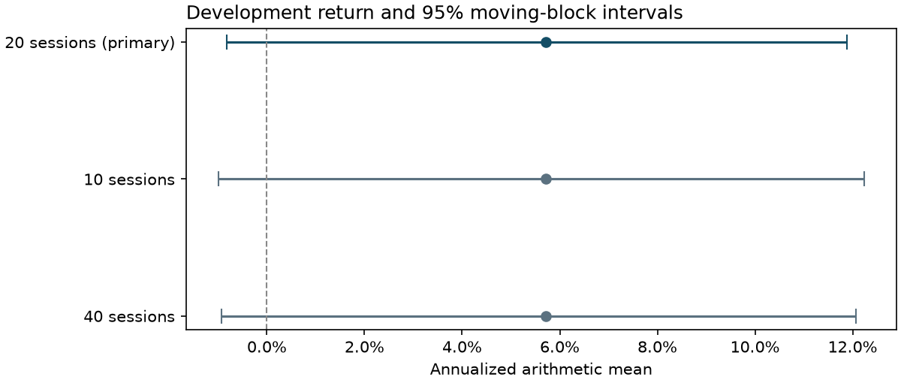

# Technical methodology appendix
## Noether Meridian · Service 02 · Unit 1
Internal methodology demonstration | 27 November 2026 | Sign-off PENDING

### Evidence classes
**A. Verified controls.** SHA-256 checks matched the prior manifests. The Phase 5 claim and single logged evaluation are consistent with the saved, exclusive-path run guard. This verifies repository custody. A local marker cannot prove an unseen execution or independently timestamp the protocol. Phase 1 had an initial calendar-boundary failure, followed by a separately preserved successful snapshot.

**B. Reproduced results.** The audit imported no strategy calculation. It reconciled each saved row in eight Phase 5 portfolios, representing 12,080 portfolio sessions. The frozen bars supplied opening, closing and distribution values. A separate loop calculated trailing-window decisions and checked opening exposure. Ledger identities checked fee, share change, capital gains, dividends, interest, cash and close value. All eight saved results also matched independently calculated geometric return, sample volatility, excess Sharpe where defined, maximum drawdown and underwater duration.

**C. Controlled challenges.** Earlier experiments intentionally injected impossible fills, missing fees, dividend double counting, bad inputs, erroneous drawdown and early period-label release. The current automated suite exercised those cases. These are synthetic error-detection checks.

**D. Open evidence.** Independent vendor price checks and real-world execution data are absent. One stock-market proxy and one holdout cannot isolate timing from exposure and financing. Selection history and point-in-time publication records are unavailable. The optional Capital Gains column was outside the Phase 1 quality-summary schema. The frozen column has zero nonzero records, and later accounting explicitly includes it.

### Calculations checked
For a 100,000 USD initial buy at 5 bp, gross spend is 100,000 / 1.0005 = 99,950.02 USD. Cost is 49.98 USD. The saved holdout SMA first bought on 2019-02-04. At the 2019-05-30 sale, gross proceeds were 103,280.34 USD and fee 51.64 USD. The audit reconciled shares at the actual opening observation and credit to prior-close holdings.

Return is current equity divided by previous equity minus one. CAGR uses a 252-session year. Sharpe compounds no return and scales the mean daily excess over sample excess volatility by square root of 252. Drawdown is the largest loss relative to a running equity peak that starts at initial capital. Duration counts consecutive underwater sessions.

The bootstrap draws uniform starting indices for overlapping noncircular blocks. A separate implementation gathers all indexed observations explicitly, truncates to the sample length and uses 2.5% and 97.5% percentiles. All three Phase 4 and six Phase 5 saved interval pairs matched. The procedure regenerates statistics from recorded returns. It does not run another portfolio or experiment.

<!-- pagebreak -->

## Bootstrap and benchmark assumptions

*Figure A1. From the verified Phase 4 evidence. All intervals include zero.*

The block method assumes a sufficiently stable process with meaningful dependence retained within blocks. The analysis did not adjust for undisclosed historical strategy selection or test joint significance across secondary comparators. Weekly and monthly labels were descriptive. The monthly history contained 47 ready labels, all long, with one initial entry transition. This small effective transition count limits interpretation.

Phase 5's 95% paired interval tests zero mean matched daily return difference. Its annualized arithmetic endpoints scale by 252. The compounded gap subtracts cumulative net wealth returns. Neither represents a difference between annualized compound rates.

### Comparability and controls
The SMA idle-cash interest is zero by specification. Benchmark cash accrues a lagged 91-day bill-price transformation from the historical FRED DTB3 snapshot. Positive-rate intervals favor the benchmark cash sleeve under this asymmetry. The difference is not identifiable by subtracting realized benchmark interest because allocations and subsequent order quantities differ. A matched-cash sensitivity requires separate authorization.

Distribution records use provider event dates as ex-date proxies. Spendable cash may arrive later. Equal 5 bp charges on traded notional do not establish equal execution realism. Orders use unrestricted fractional shares and vendor opens, without measured slippage or latency. These issues remain OPEN.

### Traceability and reproducibility
Read claim-traceability.csv for report claim groups and exact source paths. Read independent-audit.log for recorded computations and README.md for reproduction commands. The evidence compiler checked the custody trail and calculations without signing as an authorized reviewer.
